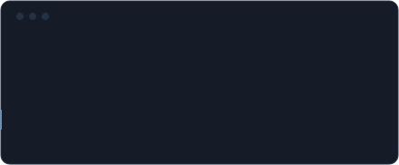

 

<code>Somewhere between what I felt and what never happened.</code>

 

<!--
  Some drafts never leave the staging area.
  This file is one of the ones that did.
-->

---

### 01 — INTRODUCTION

I'm Hasnaat, a developer, builder and technology enthusiast. I like turning rough ideas into working systems, and I care about the quiet parts of software: structure, clarity, privacy, and the things that hold up when nobody is watching.

Most of what I write starts as a question. The good ones become projects.

---

### 02 — CURRENTLY BUILDING

<table>
  <tr>
    <td width="38%"><b>ClassBoard</b></td>
    <td>An all-in-one student platform.</td>
  </tr>
  <tr>
    <td><b>Privacy-Preserving Visual Perception for Web Agents</b></td>
    <td>A hybrid AI project.</td>
  </tr>
</table>

---

### 03 — TECHNOLOGY

<table>
  <tr>
    <td width="22%">LANGUAGES</td>
    <td>Python &nbsp;·&nbsp; JavaScript &nbsp;·&nbsp; SQL</td>
  </tr>
  <tr>
    <td>FRONTEND</td>
    <td>React</td>
  </tr>
  <tr>
    <td>BACKEND</td>
    <td>Django &nbsp;·&nbsp; FastAPI</td>
  </tr>
  <tr>
    <td>DATA &amp; CLOUD</td>
    <td>Firebase &nbsp;·&nbsp; Supabase</td>
  </tr>
  <tr>
    <td>WORKFLOW</td>
    <td>Git &nbsp;·&nbsp; and the related tools that come with building</td>
  </tr>
</table>

---

### 04 — THE PROCESS

> Not every branch gets merged.
>
> Some commits change the direction.
>
> Some issues remain unresolved.
>
> Every experience leaves something behind.

Some things are never pushed. They still shape the history.

---

### 05 — CURRENT STATE

---

### 06 — CONNECT

[**GitHub**](https://github.com/hasnaat-byte) &nbsp;·&nbsp; [**LinkedIn**](https://www.linkedin.com/in/hasnaat-malik) &nbsp;·&nbsp; [**Email**](mailto:hasnaatmalik29@gmail.com)

---

 

*"Some branches exist only to teach us something about the main one."*

 

**NO ROLLBACK. NO REWRITE. JUST FORWARD.**

 

